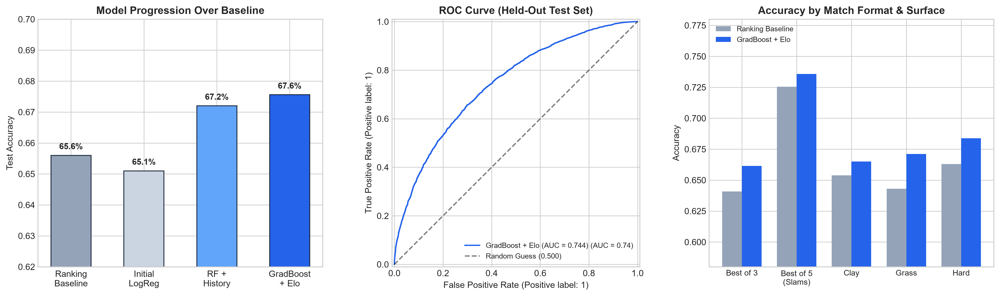

# CS360 Data Science Project: ATP Tennis Match Outcome & Surface Analysis

## Project Overview
This project analyzes professional ATP tennis matches from 2000 to 2026 to predict match outcomes and understand how playing surfaces impact match dynamics.

## Dataset
- **Source:** [ATP Tennis 2000 - 2026 Daily Update (Kaggle)](https://www.kaggle.com/datasets/dissfya/atp-tennis-2000-2023daily-pull)
- **Description:** Includes 60,000+ ATP matches with features such as tournament level, surface type, court condition (indoor/outdoor), player rankings, betting odds, and match results.

## Guiding Questions
1. **Match Outcome Prediction:** Can machine learning models (Logistic Regression, Random Forest, XGBoost) accurately predict the winner of an ATP match using pre-match statistics and rank differences?
2. **Baseline Comparison:** How do these models perform compared to a simple baseline heuristic (e.g., always predicting the higher-ranked player wins)?
3. **Surface-Specific Analysis:** Which features (rank difference, court surface, odds) are the most significant predictors of match outcomes across Hard, Clay, and Grass courts?

## Key Results & Progression

| Stage | Notebook | Model & Feature Set | Test Accuracy | ROC-AUC |
| :--- | :--- | :--- | :---: | :---: |
| **1. Heuristic Baseline** | `01_eda_and_baseline.ipynb` | Predict higher ATP-ranked player wins | 65.6% | — |
| **2. Initial Linear Model** | `01_eda_and_baseline.ipynb` | Logistic Regression (`Rank_Diff`, `Surface`, `Court`, `Best of`) | 65.1% | — |
| **3. Feature Engineering** | `02_feature_engineering_and_models.ipynb` | Tuned Random Forest (`Log_Rank_Diff`, `Pts_Diff`, Surface Win Rate, 10-Match Form, H2H) | 67.2% | 0.737 |
| **4. Final Model + Elo** | `03_evaluation_and_error_analysis.ipynb` | **HistGradientBoosting + Dynamic Elo & Rest Days** | **67.6%** | **0.744** |

### Domain Insights from Error & Slice Analysis
* **Match Length Reduces Variance:** In **Best-of-5 Grand Slam** matches, model accuracy climbs to **73.6%** (vs. **66.1%** in Best-of-3 events), confirming that longer formats filter out short-term luck and favor the higher-skill player.
* **Surface Specialization Matters:** Adding leak-free historical surface win rates produced the largest accuracy lift over ATP rankings on **Grass courts (+2.8%)** and **Hard courts (+2.1%)**, where specialists frequently outperform their 52-week overall ranking.
* **Elo vs. ATP Points:** Dynamic pre-match Elo ratings (`K=32`) and logarithmic rank differentials (`Log_Rank_Diff`) outperformed raw rank differences by reacting immediately to recent opponent strength.

## Repository Structure
* `01_eda_and_baseline.ipynb` — Data cleaning (`69,074` valid matches), exploratory visualizations, and establishing the ranking baseline.
* `02_feature_engineering_and_models.ipynb` — Chronological leak-free feature engineering (`shift(1)`), 5-fold cross-validation across Logistic Regression, Naive Bayes, KNN, and Random Forest, plus `GridSearchCV` tuning.
* `03_evaluation_and_error_analysis.ipynb` — Dynamic Elo rating calculation, Gradient Boosting evaluation on the held-out test set (`10,690` matches), and slice analysis by format and court surface.
* `figures/model_evaluation_summary.png` — Summary visualization of model progression, ROC curve, and slice accuracy.

## Methodology & Leakage Prevention
* **Chronological Feature Construction:** All rolling form (`Form_10`), career surface win rates, head-to-head records, and Elo ratings are computed strictly from matches played *prior* to the target match date.
* **Pipeline Isolation:** `StandardScaler` and `OneHotEncoder(drop='first')` are encapsulated inside `scikit-learn` `Pipeline` objects fit exclusively on training folds, with the 20% stratified test set evaluated once at the end.

## AI Use
In accordance with the course AI policy:
- **Tools Used:** Gemini / GitHub Copilot
- **Purpose:** Brainstorming ideas, write and debug code, polish explanations, and structuring repository documentation.
